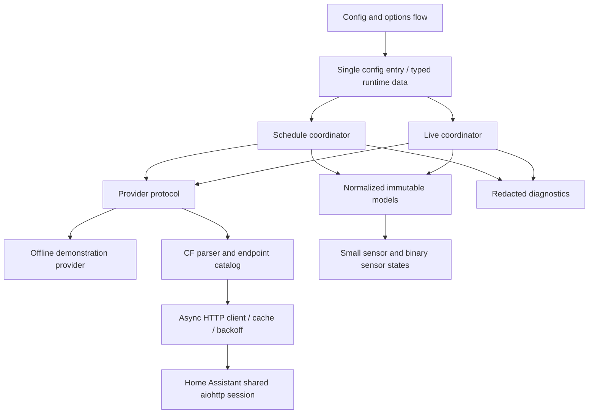

# Architecture

NASCAR Race Center is a UI-configured Home Assistant custom integration with a replaceable provider. Phase 1 supplies a working offline demonstration, an explicitly authorized CF adapter, essential entities, and the boundaries needed for later features. Live provider operation remains experimental until anonymous access and active-session behavior are independently validated.

## Layers and ownership

| Layer | Responsibility | Extension boundary |
| --- | --- | --- |
| Endpoint catalog | Documented CF URL construction and series/year validation | Add a feed only after evidence and fixtures exist |
| HTTP transport | Shared session, cancellation, timeouts, cache validators, errors and bounded backoff | No domain interpretation or entity creation |
| Provider | Parse supported field shapes and return typed models | Swap provider without changing entities |
| Models | Stable IDs, timezone-aware times, explicit optional values | Add documented facts without exposing raw JSON |
| Coordinators | Deduplicate polling, select seasons, manage freshness and failures | Separate schedules, live sessions, and future on-demand history |
| Entities | Render compact state and availability | No direct HTTP calls or full leaderboard attributes |
| Config entry | Selected series, source, authorization and options lifecycle | Version/migrate persisted configuration as needed |
| Optional frontend, later | Accessible interactive views | Dedicated package and HACS dashboard distribution |

## Configuration and lifecycle

One entry manages national series IDs 1, 2 and 3. Labels use neutral series descriptions where sponsor naming changes by season. Demonstration mode is the default and makes no NASCAR requests. CF mode requires an explicit data-use authorization acknowledgement; this records a user decision, not a legal determination by the integration.

Setup constructs one provider using Home Assistant's shared session and stores typed runtime state on the config entry. Schedule and live coordinators refresh independently before platforms are forwarded. A missing or failed optional live feed must not prevent usable schedule entities. Options changes reload the entry, and unload removes platforms, update listeners, and coordinator timers without closing Home Assistant's shared session.

## Data identity and time

Provider series/race IDs route observations. A global live feed describes its reported session; it does not establish concurrent coverage for three series. A live snapshot must never be copied to another series. Series devices and essential entity IDs remain stable across races and display-name changes. Future driver identity uses NASCAR driver ID, never car number; future event/history identity includes series, race and session IDs.

All normalized datetimes are timezone-aware. UTC is used for comparisons and Home Assistant handles user display. Ambiguous date-only or timezone-free source values must remain unknown unless source semantics are verified. Schedule refresh recomputes the next race and accounts for rescheduling; season rollover must not assume a fixed racing calendar. Missing lap, flag or result values remain unknown rather than becoming zero or a guessed status.

## Refresh and failure policy

Schedules change slowly and receive their own cache and refresh cadence. Live refresh may become moderately more frequent only near a known race or when an active session is observed; idle/off-season cadence stays low. CF polling is conditional on authorization and must stay within any established provider limits. Exact Phase 1 intervals and their limits are defined in integration constants and covered by tests.

Conditional requests honor ETag/Last-Modified where supplied. A 304 reuses a successfully cached body; it cannot create data without an existing cache. Timeouts, invalid JSON, schema drift, access denial, missing endpoints and server failures become explicit provider errors. Rate limits and service-unavailable responses honor Retry-After and bounded delayed retries; cancellation propagates. Failure of one optional feed does not disable unrelated data. Last successful models can be retained for diagnostics, but entity availability and staleness must reflect their age and failed refreshes.

The timestamp of a successful HTTP request is transport freshness. It cannot prove that a CDN's live observation is current. Live-race freshness and session lifecycle remain separate validation gates.

## Extension plan

- Phase 2 adds session-aware calendars, complete weekend schedules, per-series favorite-driver selection and driver entity factories. Schedule/reference caches remain separate from live timing.
- Phase 3 adds feed-specific capabilities for timing, flags, pits, stages and points. A session state machine and persistent event ledger suppress initial-baseline, restart and replay duplicates before automation events are enabled.
- Phase 4 adds bounded historical caches and on-demand requests keyed by season/series/race/driver. Derived statistics carry formulas, source availability and provenance; they never overwrite reported facts.
- Phase 5 adds an authenticated Home Assistant data view for larger leaderboards/history and a separate optional card package. It must avoid huge entity attributes and unnecessary Recorder writes.
- Phase 6 closes compatibility, translation, diagnostics, data-use, branding, replay and release gates. Dashboard and integration releases have distinct artifacts and compatibility checks.

## Official requirements reviewed

On 2026-10-20, the implementation was checked against Home Assistant's [manifest](https://contributors.home-assistant.io/core/integrations/manifest/), [config flow](https://contributors.home-assistant.io/core/integrations/config-flow/), and [data fetching](https://contributors.home-assistant.io/core/integrations/fetching-data/) guidance: versioned custom-component metadata, UI onboarding, and coordinator-based updates form the foundation. HACS [integration requirements](https://www.hacs.dev/docs/publish/integration/) require a single integration directory and repository/manifest metadata. HACS branding and publication approval remain pending; see [DATA_USE.md](docs/DATA_USE.md).
