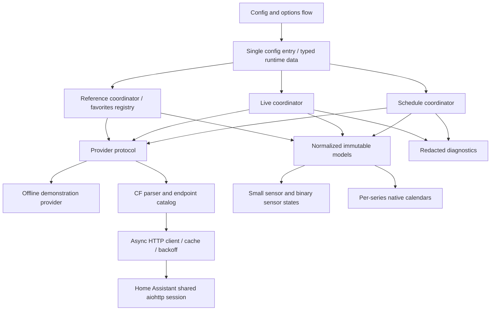

# Architecture

The October 21 [API reference audit](docs/api/AUDIT_REPORT.md) attempted all 28
documented URLs; proxy CONNECT policy prevented all origin responses. The
[reference library](docs/api/README.md) is a development/test resource only.
Production continues through the providers, shared aiohttp transport and
independent coordinators below. No saved fixture is a live fallback.

NASCAR Race Center is a UI-configured Home Assistant custom integration with a replaceable provider. Phases 1 and 2 supply schedules, calendars and favorite metadata. Phase 3A adds normalized experimental live fields and compact race/favorite timing projections. Live provider operation remains experimental until anonymous access and active-session behavior are independently validated. Community schema references and structural tests support the adapters; no direct CF validation has been performed in this environment.

## Layers and ownership

| Layer | Responsibility | Extension boundary |
| --- | --- | --- |
| Endpoint catalog | Documented CF URL construction and series/year validation | Add a feed only after evidence and fixtures exist |
| HTTP transport | Shared session, cancellation, timeouts, cache validators, errors and bounded backoff | No domain interpretation or entity creation |
| Provider | Parse supported field shapes and return typed models | Swap provider without changing entities |
| Models | Stable IDs, timezone-aware times, explicit optional values | Add documented facts without exposing raw JSON |
| Coordinators | Deduplicate polling, select seasons, manage freshness and failures | Separate schedules, driver/track references, live sessions, and future on-demand history |
| Entities | Render compact state and availability | No direct HTTP calls or full leaderboard attributes |
| Config entry | Selected series, source, authorization and options lifecycle | Version/migrate persisted configuration as needed |
| Optional frontend, later | Accessible interactive views | Dedicated package and HACS dashboard distribution |

## Configuration and lifecycle

One entry manages national series IDs 1, 2 and 3. Labels use neutral series descriptions where sponsor naming changes by season. Demonstration mode is the default and makes no NASCAR requests. CF mode requires an explicit data-use authorization acknowledgement; this records a user decision, not a legal determination by the integration.

Setup constructs one provider using Home Assistant's shared session and stores typed runtime state on the config entry. Schedule, reference and live coordinators refresh independently before platforms are forwarded. Missing drivers, tracks or live data must not prevent usable schedule entities. Options changes reload the entry, and unload removes platforms, update listeners, and coordinator timers without closing Home Assistant's shared session. The prepared Home Assistant baseline owns coordinator shutdown through config-entry unload callbacks; late refreshes cannot re-arm shutdown timers.

## Data identity and time

Provider series/race IDs route observations. A global live feed describes its reported session; it does not establish concurrent coverage for three series. A live snapshot must never be copied to another series. Series devices and the Phase 1 entity IDs remain stable across races and display-name changes. Driver identity uses NASCAR driver ID, never car number or display name, so a driver competing in multiple series shares one favorite identity. Race/session identity includes series, season and race context.

All normalized datetimes are timezone-aware. UTC is used for comparisons and Home Assistant handles user display. Ambiguous date-only or timezone-free source values must remain unknown unless source semantics are verified. Schedule refresh recomputes the next race and accounts for rescheduling; season rollover must not assume a fixed racing calendar. Missing lap, flag or result values remain unknown rather than becoming zero or a guessed status.

### Schedule and calendar models

`Race` preserves its Phase 1 fields and adds optional season, track ID, status and immutable `Session` records. A session contains its internal ID, source name, normalized kind, optional start/end, status and notes. The global race list may supply embedded sessions; the per-series schedule feed can enrich them and can provide a schedule when the basic list fails. Optional enrichment failure keeps usable basic races. Neither adapter guesses practice sessions, durations, postponement status or cancellation flags.

The corroborated schemas expose race IDs but no authoritative session ID. Internal session IDs therefore derive from stable series/season/race context plus session kind/name, excluding timestamps and list order. Rescheduling preserves the ID; renaming a session can change it. Indistinguishable duplicate session names are rejected rather than silently merged. Supported status fields in normalized models are useful for providers and synthetic fixtures; a real CF cancellation/status mapping remains an evidence gate.

The schedule coordinator queries the current season and optionally the upcoming season during November/December. An unpublished upcoming season does not invalidate current data. In January it also queries the previous season, including after a restart, to discover postponed or cross-year weekends. Only prior-season races with known future/ongoing race/session times are retained, and their prior season continues refreshing after January while those times remain. This adjacent-season policy is bounded; it is not a historical archive or a bulk historical download.

Each season refreshes independently. Failed-season rows can remain as last-good diagnostic context, but cannot supply next-race selection, calendar events or normal schedule counts. A successful optional season does not make failed current-season rows fresh. An empty current season is valid when successfully fetched; an empty optional season cannot conceal a current-season failure. A nonempty successfully fetched adjacent season can remain usable independently. Multiple successful/retained seasons are deduplicated by series, season and race ID.

One read-only native calendar per selected series projects usable season schedules. Calendar queries use half-open intervals, including overlapping events and events spanning months/years. Valid offset-aware start/end pairs become timed events. A known start without an end becomes a labeled all-day notice with the known start in its description; no race length is converted into a duration. Sessions with unknown starts are omitted. Weekend date ranges derive from known session dates in Home Assistant's timezone, with exclusive end dates. They describe the weekend's dates, not continuous track activity. Recognized canceled races/sessions are excluded. Timed events and all-day notices have stable internal UIDs and bounded descriptive metadata.

### Driver and track references

`Driver` uses a NASCAR driver ID and name, with explicit `DriverAssociation` records for supplied series/car/team/manufacturer metadata. The reference directory is not treated as an active roster. Conflicting per-series metadata stays in associations rather than inventing a single current car or team. Manufacturer values that are media URLs are omitted rather than interpreted as brands. `Track` uses a track ID and supported optional name, city/state, length in miles, type and surface; no timezone or geolocation is inferred.

The favorite registry stores selected driver IDs independently of reference availability, selected race series and metadata changes. Initial setup accepts optional numeric IDs; options expose cached named searchable choices without network work in forms. Source changes retain IDs without name/car matching; fictional demo IDs need user review when switching to CF. Phase 2 entities publish compact reference metadata, including at most three unambiguous per-series associations. Favorite live timing is independent of reference availability; pit tracking remains deferred. Driver/track reference refresh is daily, uses the shared bounded in-memory HTTP cache and isolates each feed's failure. Failed references or references older than seven days are not presented as available metadata. A failed driver refresh cannot remove saved favorite identities or disable schedules/calendars. Caches are runtime state, not persisted provider datasets.

## Refresh and failure policy

Schedules change slowly and receive their own cache and refresh cadence. Reference metadata has a separate slow refresh and per-feed freshness state. Live refresh may become moderately more frequent only near a known race or when an active session is observed; idle/off-season cadence stays low. CF polling is conditional on authorization and must stay within any established provider limits. Intervals and their bounds are defined in integration constants and covered by tests; no allowed NASCAR polling rate has been independently established.

Conditional requests honor ETag/Last-Modified where supplied. A 304 reuses a successfully cached body; it cannot create data without an existing cache. Timeouts, invalid JSON, schema drift, access denial, missing endpoints and server failures become explicit provider errors. Rate limits and service-unavailable responses honor Retry-After and bounded delayed retries; cancellation propagates. Failure of one optional feed does not disable unrelated data. Last successful models can be retained for diagnostics, but entity availability and staleness must reflect their age and failed refreshes.

The CF provider configures a 16-entry LRU response cache, enough for the usual eleven endpoints across two seasons, three selected series, driver/track references and the live feed. The basic season list's fallback cache lifetime is one hour, detailed session feeds six hours, and references 24 hours; server cache directives take precedence. Responses are capped at 2 MiB. Per-endpoint failure counters and cooldown records are each capped at 24 entries. Negative cooldowns for 401/403/404 and other failures suppress repeated requests to the same failed global schedule when the coordinator visits another series during the same refresh. A 429 applies a host-wide pause; unrelated non-rate-limit endpoint failures remain isolated.

The timestamp of a successful HTTP request is transport freshness. It cannot prove that a CDN's live observation is current. Live-race freshness and session lifecycle remain separate validation gates.

## Extension plan

- Phase 2 supplies session-aware calendars and favorite-driver metadata behind evidence-limited schedule/reference adapters. Remaining direct schema, timestamp/status and data-use gates are recorded in the evidence documents. Schedule/reference caches remain separate from live timing.
- Phase 3A supplies evidence-limited timing and session progress. Later Phase 3 assignments own pits, stages, points and automation events. A persistent event ledger and baseline/restart/replay suppression are required before events are enabled.
- Phase 4 adds bounded historical caches and on-demand requests keyed by season/series/race/driver. Derived statistics carry formulas, source availability and provenance; they never overwrite reported facts.
- Phase 5 adds an authenticated Home Assistant data view for larger leaderboards/history and a separate optional card package. It must avoid huge entity attributes and unnecessary Recorder writes.
- Phase 6 closes compatibility, translation, diagnostics, data-use, branding, replay and release gates. Dashboard and integration releases have distinct artifacts and compatibility checks.

## Official requirements reviewed

On 2026-10-20, the implementation was checked against Home Assistant's [manifest](https://contributors.home-assistant.io/core/integrations/manifest/), [config flow](https://contributors.home-assistant.io/core/integrations/config-flow/), and [data fetching](https://contributors.home-assistant.io/core/integrations/fetching-data/) guidance: versioned custom-component metadata, UI onboarding, and coordinator-based updates form the foundation. HACS [integration requirements](https://www.hacs.dev/docs/publish/integration/) require a single integration directory and repository/manifest metadata. HACS branding and publication approval remain pending; see [DATA_USE.md](docs/DATA_USE.md).

## Phase 3A live field and consumer boundary

`LiveSnapshot` preserves its original fields and positional constructor order;
`status` still means session kind. New optional run ID/name, reported total and
remaining laps, elapsed seconds and `Leaderboard` fields extend that contract.
`session_key` is `(series_id, race_id, run_id)`; absent run ID stays `None`.
The run is not equated with Phase 2's derived named schedule-session ID.
`observed_at` is local transport context and excluded from model equality.

`timing.py` holds immutable `LiveDriver`, `LedInterval` and `Leaderboard` models
and the narrow vehicles parser. A sorted tuple supports field traversal; a
read-only NASCAR-ID map supports constant-time favorite lookup. Field order is
reported position then driver ID for deterministic presentation, without claiming
ties are resolved. Leader selection requires exactly one position 1. Unsupported
positions stay unknown, not zero. Parser bounds are 100 vehicles, 1,000 laps-led
intervals per driver and 160-character text, within the existing 2 MiB transport
bound. Missing driver identities are omitted/countable. Duplicate identities or
an unusable field mark optional scoring failed while flags/laps survive.

No rows are merged across polls, races, runs or series. The single global live
coordinator replaces the whole snapshot; an older field cannot supply a missing
competitor or metric. Failed snapshots are retained only as diagnostic context.
`live.view(series_id)` returns a read-only `LiveView` containing separate health,
evidence-limited progress and an available normalized leaderboard. Its
`driver(driver_id)` helper does not depend on the general reference directory.
This is the reusable internal consumer boundary for later assignments, not a
frontend API or persistent historical/event store.

Source freshness remains separate from transport success. The view exposes
`ok`, `freshness_unknown`, `stale`, `offline`, `denied`, `not_reported` and
`no_active_session`. Fresh recognized racing flags plus a positive lap support
an experimental `active` observation; a fresh checkered flag supports
`completed`, without final-result semantics. Unknown timestamps/flags do not
establish progress. Live failures do not disable calendars or references.
No lifecycle/event transition is persisted or emitted in Phase 3A.

Favorite metrics reuse each Phase 2 driver device and global NASCAR-ID identity,
with reported series/race/run context. Six live metrics per selected favorite
are registered, with only position enabled by default; this avoids multiplying
metrics by three series or by all field entries. Race sensors use series scope.
The full normalized field is never stored in state attributes or diagnostics.
Bounded diagnostics expose counts of available timing fields and omitted rows.

Legacy live-sensor source timestamps remain attached to their last meaningful
sample. The sensor coordinator callback compares value, availability and compact
context before writing; timestamp-only updates stay in diagnostics. The optional
transport timestamp sensor is an explicit user choice. An actual in-memory
Recorder test verifies ten timestamp/other-driver refreshes add zero rows for
unchanged favorite position, current lap and leader, then one position change
adds exactly one favorite row. There is no persisted timing cache/history.

The CF provider still requests only the original global live endpoint, once per
shared refresh. No pit/flag-history/stage/points endpoint, faster minimum
interval, alternate-series polling, network permission or data-use grant was
introduced. Existing HTTP cache/backoff/cancellation and entry-owned coordinator
shutdown remain the sole polling/resource owners.
