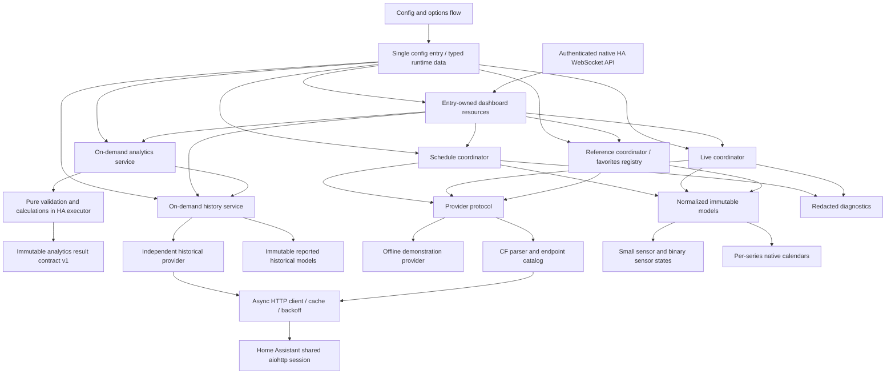

# Architecture

The October 21 [API reference audit](docs/api/AUDIT_REPORT.md) attempted all 28
documented URLs; proxy CONNECT policy prevented all origin responses. The
[reference library](docs/api/README.md) is a development/test resource only.
Production continues through the providers, shared aiohttp transport and
independent coordinators below. No saved fixture is a live fallback.

NASCAR Race Center is a UI-configured Home Assistant custom integration with a replaceable provider. Phases 1 and 2 supply schedules, calendars and favorite metadata. Phase 3A adds normalized experimental live fields and compact race/favorite timing projections. Live provider operation remains experimental until anonymous access and active-session behavior are independently validated. Community schema references and structural tests support the adapters; no direct CF validation has been performed in this environment.

## Layers and ownership

| Layer | Responsibility | Extension boundary |
| --- | --- | --- |
| Endpoint catalog | Documented CF URL construction and series/year validation | Add a feed only after evidence and fixtures exist |
| HTTP transport | Shared session, cancellation, timeouts, cache validators, errors and bounded backoff | No domain interpretation or entity creation |
| Provider | Parse supported field shapes and return typed models | Swap provider without changing entities |
| Models | Stable IDs, timezone-aware times, explicit optional values | Add documented facts without exposing raw JSON |
| Analytics | Validate immutable historical identities, calculate bounded deterministic statistics and preserve provenance | Pure calculations; entry-owned on-demand executor service for Phase 5 |
| Coordinators | Deduplicate polling, select seasons, manage freshness and failures | Separate schedules, driver/track references and live sessions; history has an independent on-demand broker |
| Entities | Render compact state and availability | No direct HTTP calls or full leaderboard attributes |
| Config entry | Selected series, source, authorization and options lifecycle | Version/migrate persisted configuration as needed |
| Optional frontend | Five accessible interactive Lovelace views against API v1 | Independent Lit/TypeScript package; manual local module, future HACS dashboard distribution |

## Configuration and lifecycle

One entry manages national series IDs 1, 2 and 3. Labels use neutral series descriptions where sponsor naming changes by season. Demonstration mode is the default and makes no NASCAR requests. CF mode requires an explicit data-use authorization acknowledgement; this records a user decision, not a legal determination by the integration.

Setup constructs one provider using Home Assistant's shared session and stores typed runtime state on the config entry. Schedule, reference and live coordinators refresh independently before platforms are forwarded. Missing drivers, tracks or live data must not prevent usable schedule entities. Options changes reload the entry, and unload removes platforms, update listeners, and coordinator timers without closing Home Assistant's shared session. The prepared Home Assistant baseline owns coordinator shutdown through config-entry unload callbacks; late refreshes cannot re-arm shutdown timers.

## Data identity and time

Provider series/race IDs route observations. A global live feed describes its reported session; it does not establish concurrent coverage for three series. A live snapshot must never be copied to another series. Series devices and the Phase 1 entity IDs remain stable across races and display-name changes. Driver identity uses NASCAR driver ID, never car number or display name, so a driver competing in multiple series shares one favorite identity. Race/session identity includes series, season and race context.

All normalized datetimes are timezone-aware. UTC is used for comparisons and Home Assistant handles user display. Ambiguous date-only or timezone-free source values must remain unknown unless source semantics are verified. Schedule refresh recomputes the next race and accounts for rescheduling; season rollover must not assume a fixed racing calendar. Missing lap, flag or result values remain unknown rather than becoming zero or a guessed status.

### Schedule and calendar models

`Race` preserves its Phase 1 fields and adds optional season, track ID, status and immutable `Session` records. A session contains its internal ID, source name, normalized kind, optional start/end, status and notes. The global race list may supply embedded sessions; the per-series schedule feed can enrich them and can provide a schedule when the basic list fails. Optional enrichment failure keeps usable basic races. Neither adapter guesses practice sessions, durations, postponement status or cancellation flags.

The corroborated schemas expose race IDs but no authoritative session ID. Internal session IDs therefore derive from stable series/season/race context plus session kind/name, excluding timestamps and list order. Rescheduling preserves the ID; renaming a session can change it. Indistinguishable duplicate session names are rejected rather than silently merged. Supported status fields in normalized models are useful for providers and synthetic fixtures; a real CF cancellation/status mapping remains an evidence gate.

The schedule coordinator queries the current season and optionally the upcoming season during November/December. An unpublished upcoming season does not invalidate current data. In January it also queries the previous season, including after a restart, to discover postponed or cross-year weekends. Only prior-season races with known future/ongoing race/session times are retained, and their prior season continues refreshing after January while those times remain. This adjacent-season policy is bounded; it is not a historical archive or a bulk historical download.

Each season refreshes independently. Failed-season rows can remain as last-good diagnostic context, but cannot supply next-race selection, calendar events or normal schedule counts. A successful optional season does not make failed current-season rows fresh. An empty current season is valid when successfully fetched; an empty optional season cannot conceal a current-season failure. A nonempty successfully fetched adjacent season can remain usable independently. Multiple successful/retained seasons are deduplicated by series, season and race ID.

One read-only native calendar per selected series projects usable season schedules. Calendar queries use half-open intervals, including overlapping events and events spanning months/years. Valid offset-aware start/end pairs become timed events. A known start without an end becomes a labeled all-day notice with the known start in its description; no race length is converted into a duration. Sessions with unknown starts are omitted. Weekend date ranges derive from known session dates in Home Assistant's timezone, with exclusive end dates. They describe the weekend's dates, not continuous track activity. Recognized canceled races/sessions are excluded. Timed events and all-day notices have stable internal UIDs and bounded descriptive metadata.

### Driver and track references

`Driver` uses a NASCAR driver ID and name, with explicit `DriverAssociation` records for supplied series/car/team/manufacturer metadata. The reference directory is not treated as an active roster. Conflicting per-series metadata stays in associations rather than inventing a single current car or team. Manufacturer values that are media URLs are omitted rather than interpreted as brands. `Track` uses a track ID and supported optional name, city/state, length in miles, type and surface; no timezone or geolocation is inferred.

The favorite registry stores selected driver IDs independently of reference availability, selected race series and metadata changes. Initial setup accepts optional numeric IDs; options expose cached named searchable choices without network work in forms. Source changes retain IDs without name/car matching; fictional demo IDs need user review when switching to CF. Phase 2 entities publish compact reference metadata, including at most three unambiguous per-series associations. Favorite live timing is independent of reference availability; pit tracking remains deferred. Driver/track reference refresh is daily, uses the shared bounded in-memory HTTP cache and isolates each feed's failure. Failed references or references older than seven days are not presented as available metadata. A failed driver refresh cannot remove saved favorite identities or disable schedules/calendars. Caches are runtime state, not persisted provider datasets.

## Refresh and failure policy

Schedules change slowly and receive their own cache and refresh cadence. Reference metadata has a separate slow refresh and per-feed freshness state. The live coordinator selects adaptive targets only within a reviewed provider policy; the current CF policy retains legacy conservative cadence. The full state/evidence, cache and restart rules are documented in [POLLING.md](docs/POLLING.md). CF polling is conditional on authorization and must stay within any established provider limits. Intervals and their bounds are defined in integration constants and covered by tests; no allowed NASCAR polling rate has been independently established.

Conditional requests honor ETag/Last-Modified where supplied. A 304 reuses a successfully cached body; it cannot create data without an existing cache. Timeouts, invalid JSON, schema drift, access denial, missing endpoints and server failures become explicit provider errors. Rate limits and service-unavailable responses honor Retry-After and bounded delayed retries; cancellation propagates. Failure of one optional feed does not disable unrelated data. Last successful models can be retained for diagnostics, but entity availability and staleness must reflect their age and failed refreshes.

The CF provider configures a 16-entry LRU response cache, enough for the usual eleven endpoints across two seasons, three selected series, driver/track references and the live feed. The basic season list's fallback cache lifetime is one hour, detailed session feeds six hours, and references 24 hours; server cache directives take precedence. Responses are capped at 2 MiB. Per-endpoint failure counters and cooldown records are each capped at 24 entries. Negative cooldowns for 401/403/404 and other failures suppress repeated requests to the same failed global schedule when the coordinator visits another series during the same refresh. A 429 applies a host-wide pause; unrelated non-rate-limit endpoint failures remain isolated.

The timestamp of a successful HTTP request is transport freshness. It cannot prove that a CDN's live observation is current. Live-race freshness and session lifecycle remain separate validation gates.

## Extension plan

- Phase 2 supplies session-aware calendars and favorite-driver metadata behind evidence-limited schedule/reference adapters. Remaining direct schema, timestamp/status and data-use gates are recorded in the evidence documents. Schedule/reference caches remain separate from live timing.
- Phase 3A supplies evidence-limited timing and session progress. Later Phase 3 assignments own pits, stages, points and automation events. A persistent event ledger and baseline/restart/replay suppression are required before events are enabled.
- Phase 4A supplies bounded on-demand history keyed by season/series/race/dataset. Phase 4B supplies pure derived statistics and an on-demand executor service with formulas, source availability and provenance; they never overwrite reported facts.
- Phase 5 adds an authenticated Home Assistant data view for larger leaderboards/history and a separate optional card package. It must avoid huge entity attributes and unnecessary Recorder writes.
- Phase 6 closes compatibility, translation, diagnostics, data-use, branding, replay and release gates. Dashboard and integration releases have distinct artifacts and compatibility checks.

## Official requirements reviewed

On 2026-10-20, the implementation was checked against Home Assistant's [manifest](https://contributors.home-assistant.io/core/integrations/manifest/), [config flow](https://contributors.home-assistant.io/core/integrations/config-flow/), and [data fetching](https://contributors.home-assistant.io/core/integrations/fetching-data/) guidance: versioned custom-component metadata, UI onboarding, and coordinator-based updates form the foundation. HACS [integration requirements](https://www.hacs.dev/docs/publish/integration/) require a single integration directory and repository/manifest metadata. HACS branding and publication approval remain pending; see [DATA_USE.md](docs/DATA_USE.md).

## Phase 3A live field and consumer boundary

`LiveSnapshot` preserves its original fields and positional constructor order;
`status` still means session kind. New optional run ID/name, reported total and
remaining laps, elapsed seconds and `Leaderboard` fields extend that contract.
`session_key` is `(series_id, race_id, run_id)`; absent run ID stays `None`.
The run is not equated with Phase 2's derived named schedule-session ID.
`observed_at` is local transport context and excluded from model equality.

`timing.py` holds immutable `LiveDriver`, `LedInterval` and `Leaderboard` models
and the narrow vehicles parser. A sorted tuple supports field traversal; a
read-only NASCAR-ID map supports constant-time favorite lookup. Field order is
reported position then driver ID for deterministic presentation, without claiming
ties are resolved. Leader selection requires exactly one position 1. Unsupported
positions stay unknown, not zero. Parser bounds are 100 vehicles, 1,000 laps-led
intervals per driver and 160-character text, within the existing 2 MiB transport
bound. Missing driver identities are omitted/countable. Duplicate identities or
an unusable field mark optional scoring failed while flags/laps survive.

No rows are merged across polls, races, runs or series. The single global live
coordinator replaces the whole snapshot; an older field cannot supply a missing
competitor or metric. Failed snapshots are retained only as diagnostic context.
`live.view(series_id)` returns a read-only `LiveView` containing separate health,
evidence-limited progress and an available normalized leaderboard. Its
`driver(driver_id)` helper does not depend on the general reference directory.
This is the reusable internal consumer boundary for later assignments, not a
frontend API or persistent historical/event store.

Source freshness remains separate from transport success. The view exposes
`ok`, `freshness_unknown`, `stale`, `offline`, `denied`, `not_reported` and
`no_active_session`. Only `ok` makes the view available for scoring, including
its leaderboard and favorite lookup. Phase 3A race scoring entities use the
same gate; unknown freshness retains models for diagnostics without exposing
current positions or timing. Phase 1 session-type, flag and current-lap behavior
remains compatible, with feed status identifying unknown freshness.
Fresh recognized racing flags plus a positive lap support
an experimental `active` observation; a fresh checkered flag supports
`completed`, without final-result semantics. Unknown timestamps/flags do not
establish progress. Live failures do not disable calendars or references.
No lifecycle/event transition is persisted or emitted in Phase 3A.

Favorite metrics reuse each Phase 2 driver device and global NASCAR-ID identity,
with reported series/race/run context. Six live metrics per selected favorite
are registered, with only position enabled by default; this avoids multiplying
metrics by three series or by all field entries. Race sensors use series scope.
The full normalized field is never stored in state attributes or diagnostics.
Bounded diagnostics expose counts of available timing fields and omitted rows.

Legacy live-sensor source timestamps remain attached to their last meaningful
sample. The sensor coordinator callback compares value, availability and compact
context before writing; timestamp-only updates stay in diagnostics. The optional
transport timestamp sensor is an explicit user choice. An actual in-memory
Recorder test verifies ten timestamp/other-driver refreshes add zero rows for
unchanged favorite position, current lap and leader, then one position change
adds exactly one favorite row. There is no persisted timing cache/history.

At Phase 3A delivery, the CF provider requested only the original global live endpoint, once per
shared refresh. No pit/flag-history/stage/points endpoint, faster minimum
interval, alternate-series polling, network permission or data-use grant was
introduced. Existing HTTP cache/backoff/cancellation and entry-owned coordinator
shutdown remain the sole polling/resource owners.

## Phase 3B optional scoring and provenance

`scoring.py` adds immutable `RaceContext`, `Provenance`, `PitStop`,
`PitActivity`, `CurrentStage`, `StageClassification`, `StageResult`,
`DriverPoints` and `ScoringFeed`. These are bounded in-memory reported facts,
independent of HA entities and suitable for future dashboard consumers. Pit
clock units and raw points-delta meanings are deliberately unspecified. Signed
pit movement comes from the source, not a rank subtraction. Zero/negative pit
clocks/laps stay unknown; zero points remain reported scores. A pit-record array
is never a completed-stop count. Stages never imply `number - 1` completed stages.

Embedded pit records belong to their parent `LiveDriver` NASCAR identity;
embedded stage descriptors belong to `LiveSnapshot`. These additions preserve
existing constructor positions/defaults and the Phase 3A parser's failure
isolation: invalid pits do not invalidate driver timing, invalid stages do not
invalidate flags. The existing live view's known-fresh, monitored-series gate
and race-session requirement apply to every new embedded sensor. No per-driver
request or field-wide entity creation is introduced.

A fourth entry-owned `ScoringCoordinator` uses `CFScoringProvider` on the same
`NascarApiClient`, fetching only provider-declared `polling_kinds` independently.
CF declares none until identity/source-time evidence supports live association;
its capability sensors report `unsupported_association`, including during a
primary outage. Normalized parsers and direct adapter reads remain available.
The coordinator keeps whole last-good datasets for diagnostics, replacing each successful snapshot
rather than merging missing rows from old polls. Each feed has independent
failure/status/retry state; cancellation propagates to HA. Transport negative
cooldowns, server retry hints and host-wide 429 pauses still apply. Optional
schema/network failures cannot invalidate schedule/reference/live coordinator
state. The 16-entry LRU retains room for future scoring sources; unsupported CF
feeds consume no cache slots or requests.

Polling of eligible optional feeds is at least 15 minutes during a supported
active race and six hours otherwise; the configured live interval can only lengthen the
active minimum. The initial refresh samples each eligible source once, independent
of favorite/series count. CF makes zero standalone scoring requests at setup or
on later refreshes; its three-series startup budget remains seven GETs in the
mocked single-season case with unavailable references. A transition from idle
can wait until the existing optional refresh deadline; no extra transition poll or alternate/historical URL
fallback is scheduled. Source cache fallback is 15 minutes, honoring upstream
cache directives/validators. These are engineering defaults, not NASCAR-approved
polling rates. The default demo returns no live scoring and performs no requests.

The scoring consumer boundary is `capability(kind, series_id)` / `feed(...)`.
It requires healthy fresh primary context, a race session, a healthy optional
feed, a single complete matching positive series/race/run identity, comparable
run namespaces and the optional source's own fresh content clock. Historical
scope, conflicting contexts, mismatches, unknown IDs, unverified namespaces and
stale/unknown source times remain separate capability states. There is no
car/name/membership-ID match, receipt-time join or copied active ID. Season
conflicts are rejected when supplied; no year is invented from receipt time.
`Provenance.retrieved_at` is the local adapter-read time, including cache hits;
it does not claim that a new HTTP request or source update occurred.

**Actual CF boundary:** global pits supply no context or NASCAR driver IDs;
stages supply race/run but no series or source clock and have an unverified run
namespace; points observed zero context IDs and no source clock. None is attached
to active live scoring or automatically requested. Normalized parsers/models and
bounded diagnostics remain available for future evidenced provider integration.
Synthetic trusted-provider tests exercise the available path without inventing CF fields or enabling a manual
association override. All scoring feeds remain provisional; checkered cannot
make them official. Standings movement, official results and scoring formulas
remain unavailable where unsupported by evidence.

Current stage is enabled per series, alongside three diagnostic capabilities.
Race stage-result-set count and championship-leader summaries are opt-in. Each
favorite registers three opt-in summaries (last reported pit lap, highest
numbered reported stage position with its reported points, provisional
championship position with supplied totals/race points). Ambiguous same-lap pit
records cannot supply a latest pit. No full datasets enter state attributes;
no advancing timestamps enter these new sensor states. Recorder tests measure
unchanged samples and one meaningful pit update. Existing IDs, favorite device
ownership and configuration version remain unchanged; removal recognizes only
owned metric suffixes. HA unload owns all polling, the live listener and optional
source-expiry timer, including failed/cancelled setup and late completion.

## Phase 3C event boundary

`events.py` consumes immutable `LiveSnapshot`/`Race` observations, independently
of provider JSON, HA actions and endpoint selection. `EventPreferences` and
`RacingEvent` define typed opt-in behavior and the small public payload.
`EventEngine` has one global live baseline plus bounded durable session clocks,
progress, completion marks, hashed event IDs and sent-reminder identities.
Persistence excludes the field, raw data and driver/pit histories. Eviction
advances replay floors. First/recovered/switched/gapped observations baseline
silently; unknown/stale/failed/future clocks break continuity. Complete matching
race/run identity and meaningful changes are required. Missing driver data never
counts as a top-N crossing. Checkered is a single observed flag-completion event;
no official results or unsupported scoring transitions are exposed.

`event_runtime.py` owns one live listener, one schedule listener, a bounded
32-item queue, one serialized async worker, one local reminder timer and a private
versioned HA Store ledger. It writes replay barriers and verifies a Store read-back before bus publication,
drops pending publication after source loss/switch/unload, and fails closed on
ledger errors without disabling entities. At-most-once delivery can omit an event
if HA stops between save and publish; it never replays a catch-up outbox. The
entry registers cleanup before initial refresh and starts listeners only after
platform setup succeeds. Reload/unload/failure stop timers/listeners and drain an active writer before replacement setup;
entry removal removes only its own ledger. Disabled events attach no listeners,
start no timer and perform no storage work. Existing polling and CF eligibility
are unchanged. Reminders use existing fresh schedules with one local deadline.

Blueprints are user-enabled HA automations outside the event engine. The
notification blueprint invokes only user-chosen actions. The optional lighting
blueprint snapshots an HA scene and restores it in queued execution before the
next effect; rapid events cannot cancel restoration. Standard scenes/lights are
brand-independent. Physical device/HA shutdown limitations and the exact stable
namespace/payload/retention contract are documented in [EVENTS.md](docs/EVENTS.md).
The Phase 5 dashboard and its dedicated data interface remain future work.

## Phase 3D-A compatibility and diagnostics

The [compatibility review](docs/PHASE3DA_VALIDATION.md) corroborates production
field shapes against the imported observed profiles, separately from live
acceptance. Session/live models retain numeric run/flag codes alongside existing
normalized meanings; numeric directory Team values stay in bounded
`DriverAssociation.team_raw` and do not become display names or join keys.
Optional schedule enrichment with contradictory track IDs fails independently
while valid basic races survive. Offset-free clocks remain unknown.

Transport retains at most 24 fixed diagnostic outcomes, independent of its
unchanged response cache/cooldowns. The CF adapter separately retains at most
24 parser outcomes, with season/series-specific schedule keys. Diagnostics join
these outcomes to existing coordinator health and per-series usable-timing
projections without exporting provider bodies, headers, names or secrets. Cache
reuse cannot advance response time or source freshness. Existing polling,
configuration/entity identity, demo and Phase 3C event ownership are unchanged.

## Phase 3D-B polling boundary

`polling.py` makes pure decisions over existing immutable observations and fresh
selected-series schedules. `PollingLimits` belongs to the provider, independent
of user options. CF's unverified-cadence record disables adaptive activation;
offline synthetic providers can exercise ten-second targets. Practice and
qualifying use fresh complete run identity and reported on-track activity without
race-lap/flag prerequisites. These decisions do not change event or sensor status
meanings. The live coordinator applies provider, clock-stall, error and transport
limits, and a schedule listener re-arms that same HA scheduler after revisions.
There is no new independent live timer/loop or extra consumer-originated request.

The transport coordinates eligible request slots even when cache policy requires
revalidation or no-store. Its fallback lifetime can follow a reviewed shorter
provider limit; explicit upstream cache lifetimes remain authoritative. 304 Age
and Date handling, long upstream lifetimes and Retry-After on success/denial are
covered synthetically. Attempt and successful-response times remain distinct
from source time. Source expiry and unchanged-value Recorder suppression remain.

One bounded CF client is retained per entry in `hass.data` through reloads; entry
removal releases it. The only new persistent state is `polling_storage.py`'s
verified-before-I/O live request reservation and optional host-wide 429 deadline.
A real restart restores those deadlines without source bodies or validators;
live data can stay unavailable until eligible. A storage error blocks live I/O.
Existing event-ledger ownership, durable publication barriers, standalone scoring
eligibility, schedules/references and shared HA session ownership are preserved.
See [Phase 3D-B validation](docs/PHASE3DB_VALIDATION.md).

## Phase 4A on-demand history boundary

`history_models.py` defines immutable reported history, complete `HistoricalRaceKey`,
strict dataset/status enums and compact request/validation/cache provenance.
`history_parser.py` implements only observed profiles 13–19, preserving namespaces,
nulls, unknown codes, source field distinctions and candidate sentinels. Archived
pit/stage parsing reuses Phase 3B without changing its live association rules.
`history_provider.py` supplies independent CF and offline fictional adapters.
`history.py` exposes `entry.runtime_data.history.async_get(key, datasets)` for future
Phase 4B/5 consumers. No coordinator, startup detail refresh or live timer owns it.

The broker deduplicates identical concurrent selections, bounds unique in-flight
keys to eight and cancels upstream work after the last consumer cancels. The shared
HTTP client supplies the existing lock, timeout, size, validator and host-backoff
controls with a separate two-document historical LRU. Its current 16-entry
live/schedule/reference cache remains independent. Historical raw bodies and
validators are ephemeral and are cleared on failed/cancelled setup, unload/reload
and HA stop; no historical state goes to HA Store, Recorder or entity attributes.
Existing compact host-wide throttling and event state retain their prior semantics.

Datasets remain independently available and are never implicitly joined. Requested
path context is distinguished from reported source identity; matching numeric run
IDs across namespaces, car numbers and names do not authorize joins. No source
field establishes official finality or publication state. All three series and
multiple years are exercised synthetically; actual cross-context CF coverage
remains unverified. Read [HISTORY.md](docs/HISTORY.md) for the exact fields, status
contract, resource/retention/request budgets, lifecycle and remaining limitations.

## Phase 4B analytics boundary

`analytics_models.py` defines frozen/slots query/result contract v1.
`analytics_validation.py` aligns response/provenance/race/driver/lap/stage/run
identities and source bounds, independently rejecting invalid peers.
`analytics_laps.py` calculates recorded series, exact descriptive statistics,
population consistency, gaps, position progression and contiguous windows.
`analytics.py` assembles same-race comparisons and selected reported
result/stage/loop/average/session rows. These modules perform no I/O, use no HA
APIs and read no clocks. Their output never infers conditions or officiality.

`analytics_runtime.py` exposes `entry.runtime_data.analytics.async_get(query,
datasets)` and delegates explicit retrieval once to the existing HistoryService.
Calculations run through HA's executor, with two distinct in-flight selections;
identical selections share one task. Pure workers are drained even after
cancellation before releasing a slot. Setup registers entry/HA-stop cleanup
before refreshes; unload/reload/failed setup closes the service. No scheduler,
completed result cache, endpoint, entity, Recorder or storage change is added.
History's request/cache/backoff ownership remains intact.

Eight selected drivers, 5,000 selected lap numbers, 60,000 projected rolling
points and 28 pairs bound work/output; source history limits remain. Position
observations and official-unverified reported laps-led values remain separate.
All-available and common-valid-numbered-lap bases are explicit; missing laps
break windows. Stage disagreements retain both sources with conflict flags.
Timing/weekend/results/stage run namespaces remain separate, and pits remain
race-scoped. Formula, field, unit, availability, sample and retention contracts
are documented in [ANALYTICS.md](docs/ANALYTICS.md), with executed checks in
[Phase 4B validation](docs/PHASE4B_VALIDATION.md). Phase 5 owns future authenticated
transport, visualization and client-specific presentation.

## Phase 5A authenticated dashboard boundary

`websocket.py` registers dashboard API v1 through supported Home Assistant
WebSocket extensions. Every command checks active administrator status, the
loaded NASCAR config entry and selected series. HA has no general config-entry
read ACL for full datasets, so v1 fails closed for all non-administrators rather
than treating visibility of a compact entity as permission to read race history.
Authorization is checked again before async delivery and subscription emissions.

`RuntimeData.dashboard` owns client listeners, a single pending 100 ms coalescing
callback per subscription, request admission and cancellation/drain. It listens
to existing coordinators (including local content expiry); it creates no NASCAR
poll or refresh trigger. Native HA owns authentication, queues, unsubscribe and
socket backpressure. No per-user state is shared outside its entry. Reload,
unload, failed setup and stop drain work and release listeners. Stop listeners
remain removable after firing, avoiding duplicate once-listener removal when an
entry subsequently unloads during shutdown.

`dashboard_views.py` reads cached normalized consumer views. Explicit field
allowlists in `dashboard_schema.py` avoid raw dictionaries and automatic model
serialization. `dashboard_pages.py` flattens large normalized collections at row
boundaries in the HA executor. Schedule/live-detail pages use content digests.
History/analytics use `dashboard_snapshots.py`: one full projection/hash builds an
immutable serialized row index; continuations decode only requested rows without
service calls, refetches or recalculation. Opaque snapshot tokens bind content,
entry runtime, user, socket and exact selection. Four globally reserved slots,
two per user, 24 MiB/100,000 rows each and fixed 300-second expiry explicitly bound
retention. Disconnect, unload/reload and stop release completed snapshots; canceled
workers retain reservations until drained. Oversized selections fail before issuing
a token. The HTTP cache remains two documents and the 60-second floor is unchanged.
Pages retain at most 200 returned records and fit a 256 KiB envelope budget. Existing
history/analytics services retain retrieval, cooldown, coalescing, computation,
provenance and cancellation ownership. No formula moves into transport.

Full leaderboards remain ephemeral dedicated views. Live embedded/scoring arrays
have explicit two-record previews and paged detail commands. No entity IDs,
Recorder attributes, event semantics, live cadence permissions or startup GET
budgets change. The [full contract](docs/DASHBOARD_API.md) defines Phase 5B's
consumption boundary; its model declarations are documentation only. No frontend
assets, card/resource registration, production installation or release is included.

## Phase 5B optional frontend

The independently versioned `frontend/` Lit/TypeScript package registers
`nascar-race-center-card` and its in-UI editor. The Python integration release
package and `hacs.json` are unchanged. [Frontend architecture and manual installation](docs/FRONTEND.md)
describe the module boundaries, supported configuration, compatibility and future
separate HACS plugin plan. No backend contract change was required.

One typed client consumes the eight authenticated v1 commands and imports shared
leaf-model declarations. Per-card generations isolate entry/series/race choices;
one selected-series live subscription exists only on overview/timing views.
Disconnect/config changes discard late work, clear pacing/countdown timers and
remove listeners/subscriptions. Unrelated HA entity updates do not rerender the
card. Native HA owns tokens/socket/reconnection and sent-request cancellation;
card recovery bootstraps a fresh connection-bound selection.

Historical/analytics selections retain at most two views/card and eight pages
(1,600 records)/view. Explicit 200-record pages follow returned offsets/tokens,
retain source order, discard changed streams and replay evicted offsets on the
same immutable snapshot. Tabs reuse views. The server's two-user/four-global
snapshot cap, fixed expiry and computation/request budgets remain authoritative.
A shared per-connection/entry request lane paces commands; no client poll or
refresh is added. Cached current-event metadata is matched by race ID, never
borrowed from another event. Live freshness is withheld on stale/unknown/unavailable
sources. Backend analytics metrics, units, classifications and null gaps survive
in bounded charts, tables and progressive record disclosure.

Original CSS graphics, HA theme properties, tabular timing, container-query
layouts, keyboard/focus semantics and reduced-motion rules make the card usable
at phone/tablet/desktop/wall widths. [Phase 5B validation](docs/PHASE5B_VALIDATION.md)
records actual browser screenshots, axe results, production-bundle measurements,
contract tests and remaining Phase 5C polish. Test-only rich fictional data is
excluded from the runtime bundle; the real offline provider retains its honest
empty live/lap states. No NASCAR requests, controlled assets, entities, Recorder
rows, production installation, publication or release are introduced.

## Phase 5C frontend refinement

Card 0.5.1 preserves API v1 and the existing Lit component boundaries. Its density
control is per-instance memory; narrow timing-column disclosure belongs to the
tower instance. Container queries apply to actual card/tower widths. Keyed driver
rows keep identity/focus through updates, and source-context invalidation recovers
focus after closing the inline detail region. No global preferences, frontend
polling or backend state are introduced.

Chart inspection selects existing backend observations, including explicit nulls;
it never recalculates metrics or bridges absent laps. A single active inspector
and bounded native selectors avoid thousands of tab stops. Source-range coverage
and existing 1,600-record retention remain visible. All-null series keep their
table; record-specific summaries preserve complete wrappers/namespace evidence.
PageView.jump reuses cached immutable offsets and retains previous navigation.
The card's selection registry can restore either History or Analytics without a
new command, while the server remains authoritative for snapshot expiry/capacity.

[Frontend instructions](docs/FRONTEND.md) describe the controls and
[Phase 5C validation](docs/PHASE5C_VALIDATION.md) records executed browser,
accessibility, performance and device acceptance evidence. Python behavior,
authentication, providers, entities, Recorder and event behavior are unchanged.
